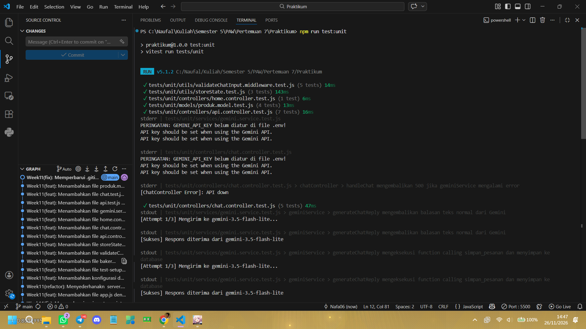
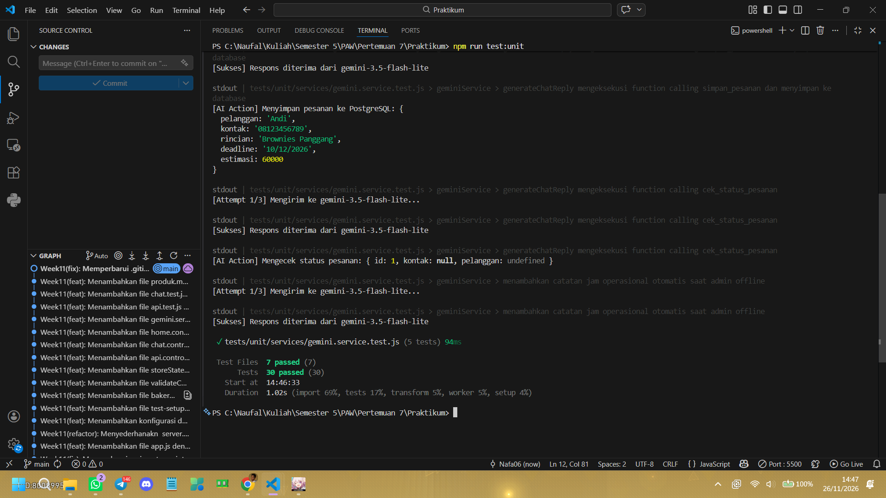
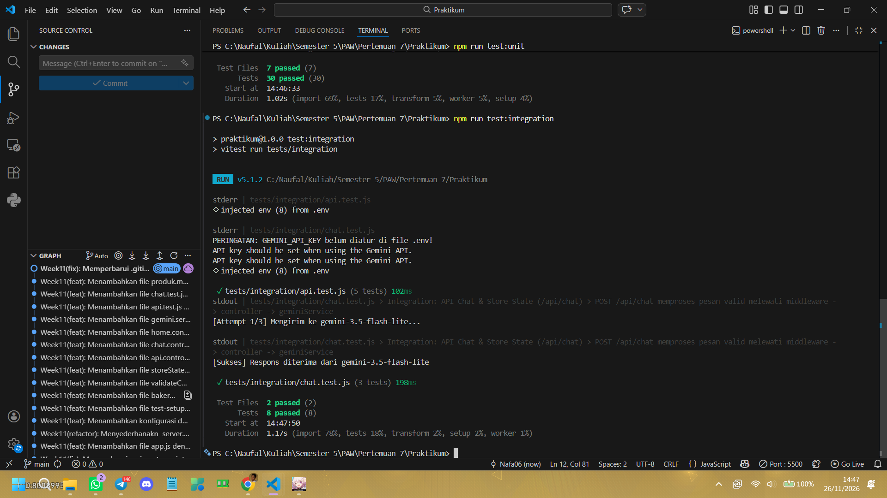
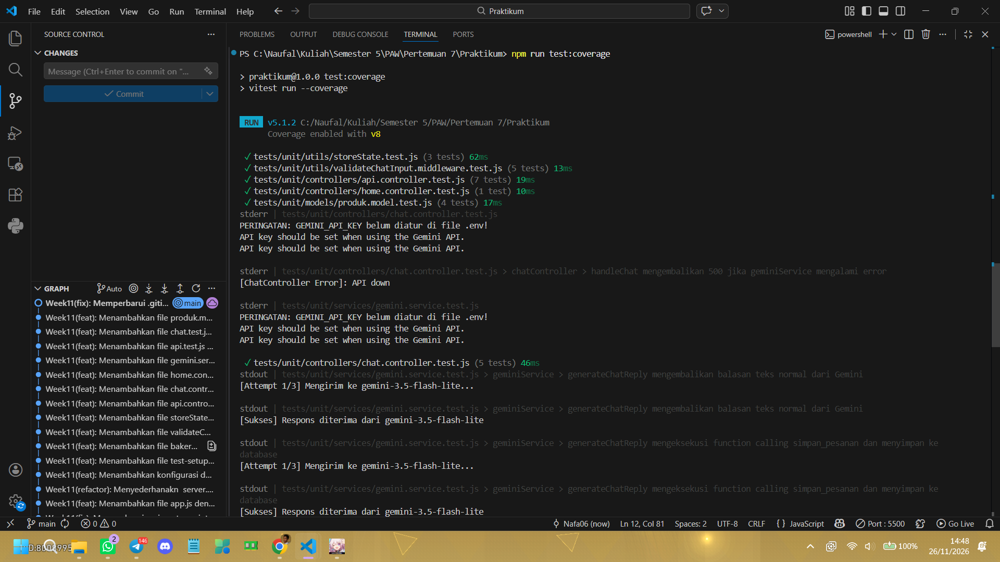
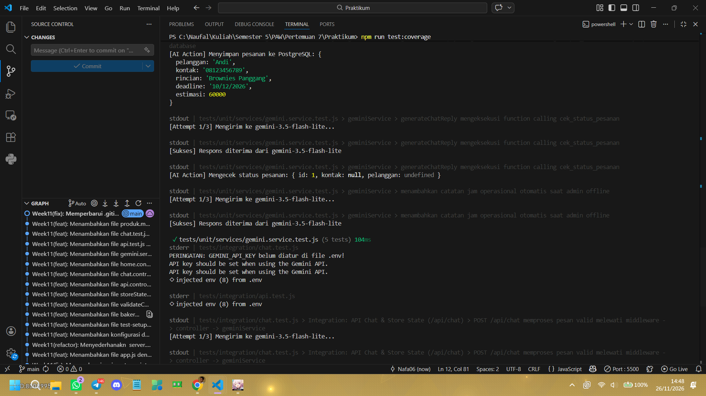
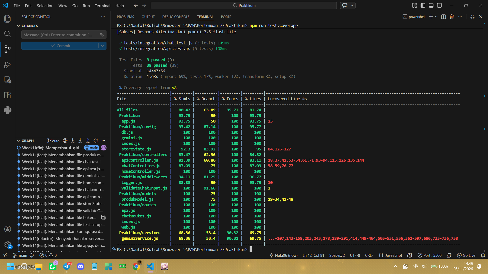
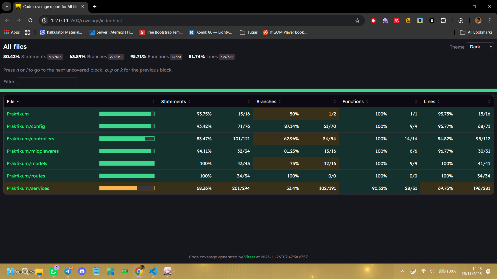

Langsung timpa atau buat file **`README.md`** di root folder proyekmu dengan isi di bawah ini. Strukturnya sudah disesuaikan dengan arsitektur terbaru proyekmu (termasuk pemisahan `app.js` & `server.js`, daftar endpoint, dan dokumentasi testing Vitest + Supertest):

```markdown
# BakeryBot — Asisten Pemesanan Kue Otomatis (Express + PostgreSQL + Gemini AI + WhatsApp)

Aplikasi web dan chatbot customer service otomatis untuk toko kue berbasis **Express.js**, **PostgreSQL**, **Google Gemini API (`@google/genai`)**, dan **WhatsApp Web (`whatsapp-web.js`)**. Dilengkapi dashboard admin untuk memantau pesanan, mengatur kuota produksi mingguan, serta mengontrol status operasional toko.

## Fitur Utama

1. **Integrasi LLM & Function Calling (`@google/genai`)**
   - Menjawab pertanyaan pelanggan seputar katalog kue, estimasi harga, dan biaya tambahan secara otomatis.
   - Mendukung *Function Calling* untuk mengecek ketersediaan jadwal/bentrok pesanan, menyimpan pesanan baru langsung ke database, dan melacak status pesanan pelanggan.
2. **Guardrail & Validasi Berlapis (*Defense in Depth*)**
   - Validasi input di level middleware (`validateChatInput.js`) untuk membatasi panjang karakter dan memblokir pola *prompt injection*.
   - Validasi format data pesanan (nomor WA, nama pelanggan, format tanggal deadline) dan kalkulasi estimasi harga otomatis di controller.
3. **Manajemen Operasional Toko & Admin Takeover**
   - Otomatis menutup order (`AUTO_WEEKLY_LIMIT`) jika kuota pesanan mingguan penuh, atau dikunci manual oleh admin (`ADMIN_LOCK`).
   - Mendukung *Admin Takeover* (menjeda bot sementara saat admin membalas langsung di jam operasional `09:00 - 21:00 WIB`).
4. **Integrasi Multi-Channel**
   - Dapat diakses melalui simulasi chat di dashboard web maupun langsung melalui WhatsApp Web.

---

## Struktur Folder

```text
PAW-Project-Chatbot_Bakery/
├── app.js                                        # Konfigurasi Express, middleware, dan routing
├── server.js                                     # Entry point server & inisialisasi WhatsApp Web
├── vitest.config.js                              # Konfigurasi Vitest & V8 code coverage
├── package.json
├── config/
│   ├── db.js                                     # Koneksi pool PostgreSQL (pg)
│   ├── gemini.js                                 # Inisialisasi client Google Gemini (@google/genai)
│   ├── index.js                                  # Konfigurasi aplikasi & port
│   └── storeState.js                             # Manajemen status toko, jam operasional, & takeover
├── controllers/
│   ├── apiController.js                          # Handler REST API produk & CRUD pesanan
│   ├── chatController.js                         # Handler endpoint chat AI, reset sesi, & store state
│   └── homeController.js                         # Render halaman dashboard EJS
├── middlewares/
│   ├── logger.js                                 # Pencatatan log HTTP request ke file Markdown
│   └── validateChatInput.js                      # Validasi panjang input & guardrail prompt injection
├── models/
│   └── produkModel.js                            # Query PostgreSQL (katalog_dasar, biaya_tambahan, rekap_pesanan)
├── routes/
│   ├── index.js                                  # Router utama
│   ├── api.js                                    # Endpoint /api (status, produk, pesanan)
│   ├── chatRoutes.js                             # Endpoint /api/chat (chat, reset, store-state)
│   └── web.js                                    # Route halaman web (/)
├── services/
│   ├── geminiService.js                          # System prompt, cache katalog, cek kuota, Function Calling
│   └── whatsappService.js                        # Integrasi bot WhatsApp Web & admin takeover
├── views/
│   └── index.ejs                                 # Tampilan dashboard pesanan & simulasi chat
└── tests/
    ├── setup/
    │   └── test-setup.js                         # Setup environment testing
    ├── fixtures/
    │   └── bakeryData.js                         # Mock data katalog & pesanan untuk pengujian
    ├── unit/
    │   ├── controllers/
    │   │   ├── api.controller.test.js
    │   │   ├── chat.controller.test.js
    │   │   └── home.controller.test.js
    │   ├── models/
    │   │   └── produk.model.test.js
    │   ├── services/
    │   │   └── gemini.service.test.js
    │   └── utils/
    │       ├── storeState.test.js
    │       └── validateChatInput.middleware.test.js
    └── integration/
        ├── api.test.js                           # Integration test endpoint /api
        └── chat.test.js                          # Integration test endpoint /api/chat

```

---

## Cara Install & Menjalankan

1. **Siapkan database PostgreSQL** dengan tabel `katalog_dasar`, `biaya_tambahan`, dan `rekap_pesanan`.
2. **Dapatkan Gemini API Key** dari [Google AI Studio](https://aistudio.google.com/app/apikey).
3. **Buat file `.env**` di root proyek dan isi konfigurasi environment:
```env
PORT=3000
DB_HOST=localhost
DB_PORT=5432
DB_USER=postgres
DB_PASSWORD=password_db_kamu
DB_NAME=nama_db_kamu
GEMINI_API_KEY=api_key_gemini_kamu

```


4. **Install dependency:**
```bash
npm install

```


5. **Jalankan server:**
```bash
npm start

```


Akses dashboard web melalui `http://localhost:3000` dan scan QR Code WhatsApp di terminal jika ingin menghubungkan bot WhatsApp.

---

## Testing & Code Coverage

Proyek ini menggunakan **Vitest** untuk unit testing, **Supertest** untuk integration testing HTTP endpoint, dan **`@vitest/coverage-v8`** untuk laporan *code coverage*. Koneksi PostgreSQL dan API Google Gemini di-*mock* selama pengujian sehingga test berjalan cepat tanpa mengubah data asli.

```bash
# Menjalankan seluruh unit test dan integration test
npm test

# Menjalankan khusus unit test
npm run test:unit

# Menjalankan khusus integration test
npm run test:integration

# Menjalankan seluruh test beserta laporan code coverage
npm run test:coverage

```

---

## Daftar Endpoint

### Halaman Web

| Method | Endpoint | Keterangan |
| --- | --- | --- |
| `GET` | `/` | Dashboard katalog, rekap pesanan, kontrol toko, dan simulasi chat |

### REST API Produk & Pesanan (`/api`)

| Method | Endpoint | Body | Keterangan |
| --- | --- | --- | --- |
| `GET` | `/api/status` | - | Mengecek status server, uptime, dan waktu server |
| `GET` | `/api/produk` | - | Mengambil daftar katalog dasar, biaya tambahan, dan rekap pesanan |
| `POST` | `/api/pesanan` | `{ pelanggan, kontak, rincian, deadline, estimasiManual? }` | Membuat pesanan baru dengan kalkulasi estimasi otomatis |
| `PUT` | `/api/pesanan/:id` | `{ rincian?, estimasi?, status? }` | Memperbarui data atau status pesanan berdasarkan ID |
| `DELETE` | `/api/pesanan/:id` | - | Menghapus pesanan berdasarkan ID |
| `POST` | `/api/pesanan/dummy` | - | Menambahkan data pesanan dummy |
| `DELETE` | `/api/pesanan/clear` | - | Menghapus seluruh data di tabel `rekap_pesanan` |

### API Chatbot & Store State (`/api/chat`)

| Method | Endpoint | Body | Keterangan |
| --- | --- | --- | --- |
| `POST` | `/api/chat` | `{ message, sessionId? }` | Mengirim pesan ke chatbot Gemini (dengan validasi & *Function Calling*) |
| `POST` | `/api/chat/reset` | `{ sessionId? }` | Mereset riwayat sesi percakapan dan melepas *admin takeover* |
| `GET` | `/api/chat/store-state` | - | Mengambil status operasional toko dan batas kuota mingguan |
| `POST` | `/api/chat/store-state` | `{ isFullOrder?, forceManual?, adminManualOffline?, maxPesananPerMinggu?, estimasiBukaOrder? }` | Mengubah status operasional toko dari dashboard admin |

## Hasil Tampilan Praktikum

Berikut adalah bukti screenshot Tugas Pertemuan 11 yang sudah berhasil dijalankan:







